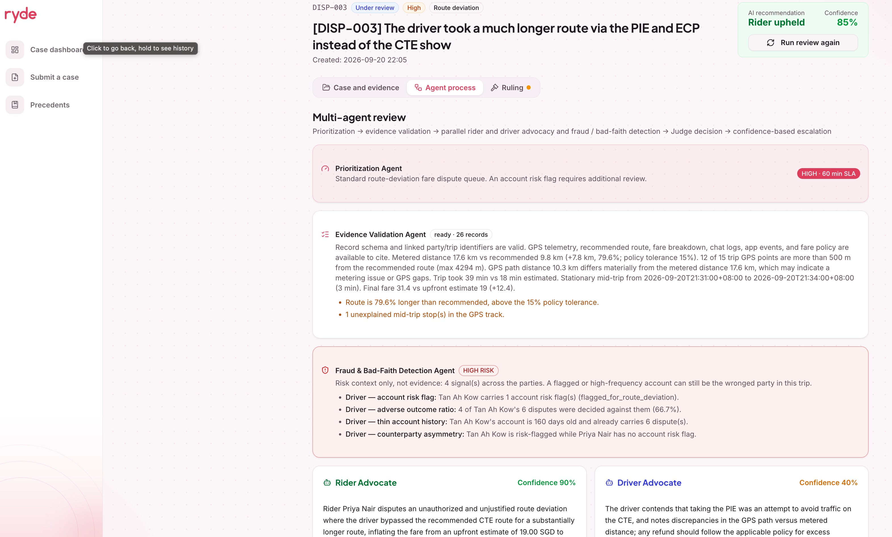
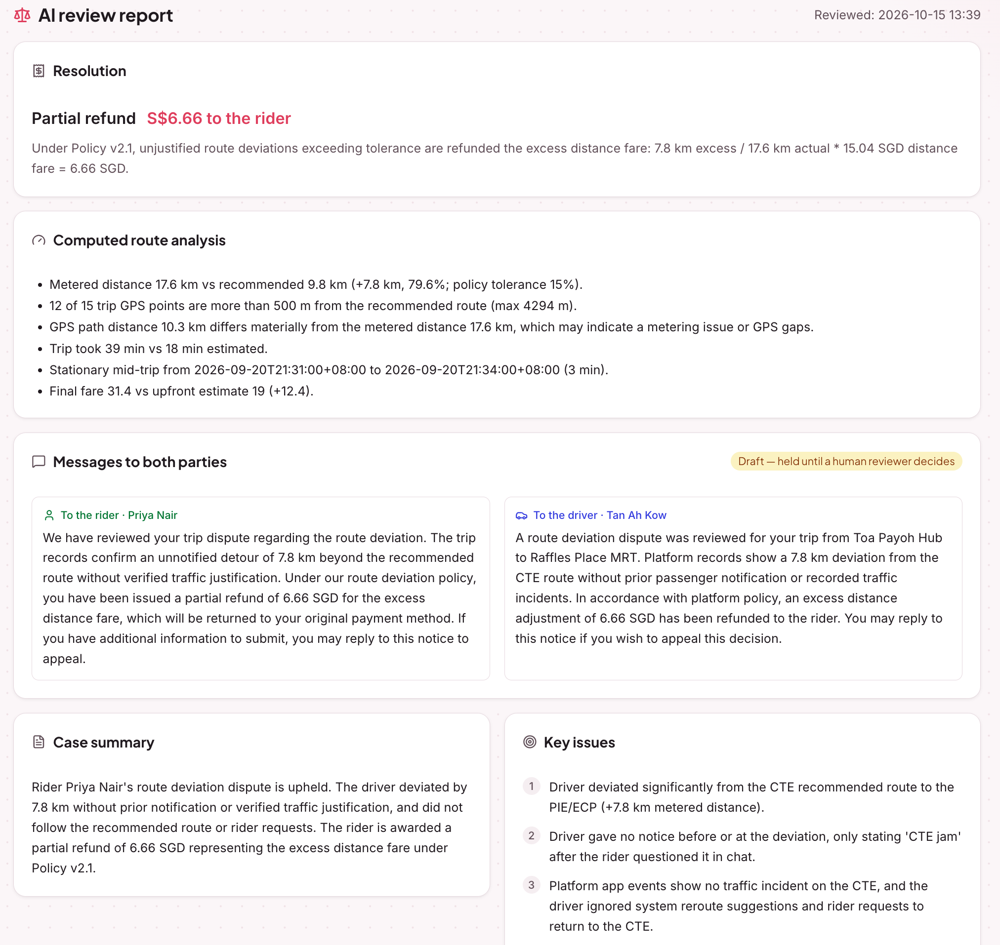
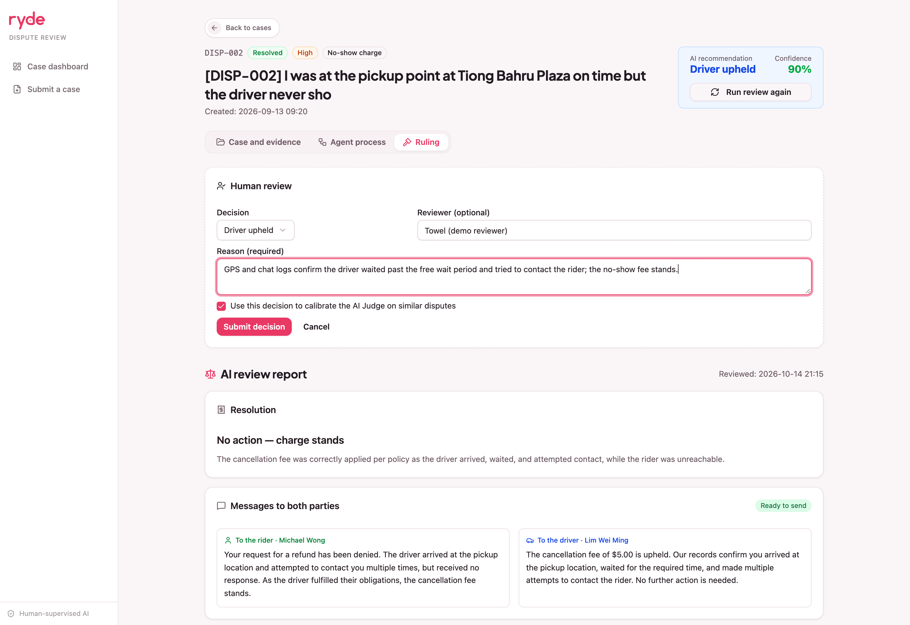
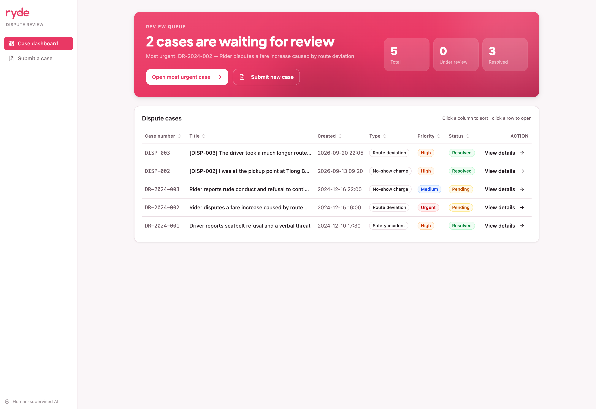

# RydeResolve

**Multi-agent AI that resolves ride-hailing disputes fairly and fast.**

Submission for the Tencent Cloud AI Singapore Hackathon 2026 · Digital Native Track · *Multi-Agent Autonomous Dispute Resolution System* (Ryde).


## The problem

Ride-hailing platforms handle thousands of rider–driver disputes a day. According to the hackathon brief, manual review takes **24–72 hours per dispute**, costs a lot in support hours, gives **inconsistent rulings**, and drives users away. A human reviewer has to cross-check GPS traces, chat logs, app events, fare breakdowns and company policy by hand.

## What RydeResolve does

A reviewer submits a case (or imports a dataset) with evidence from the driver, the rider and the platform. A pipeline of agents then reviews it:

1. **Prioritization Agent** assigns a priority and a response-time target.
2. **Evidence Validation Agent** checks the record and computes route measurements (distance, off-route points, unexpected stops, fare arithmetic) with ordinary code, so the agents cite measured numbers instead of guessing.
3. **Rider Advocate** and **Driver Advocate** run in parallel. Each argues one side from the same record and cites exact evidence paths.
4. **Fraud & Bad-Faith Detection Agent** runs alongside them without a model call. It turns account risk flags, dispute history and account age into risk signals that the Judge sees as context, never as evidence.
5. **Judge** must answer a mandatory checklist, then rules with a structured resolution (action, amount, recipient) and plain-language notices for both parties.
6. **Escalation gate (Policy v2.1):** the case is resolved automatically only when the Judge is confident enough for the dispute's stakes. Safety incidents, disputes over SGD 50 and route deviations over 2 km always go to a human. Otherwise the Judge needs 80% confidence (no minimum under SGD 10), or 95% when either party has a fraud flag. An inconclusive ruling also goes to a human, with the full agent transcript.
7. **Learning feedback:** when a reviewer overrides the AI and marks the decision as a precedent, the Judge sees it as a calibration example on similar cases. No model fine-tuning is involved.

Everything the agents say to each other is visible in the case page, so a reviewer can see how the ruling was reached.

**Dispute types handled:** route deviation, fare and surge pricing, no-show charge, property damage, safety incident. The app ships two samples to load in one click: DISP-003 (route deviation) and DISP-002 (no-show). The fare-dispute and DISP-001 route-deviation documents in [`reference/`](reference/) can be imported as files. Property damage and safety incidents have Judge checklists but no sample data yet; safety incidents always go to a human.

## Screenshots

| Rider vs driver advocates | Resolution and notices to both parties |
|---|---|
|  |  |
| **Human decision form** | **Dashboard: review queue and sortable case list** |
|  |  |

More screenshots are in [`proof/screenshots/`](proof/screenshots/).

## Tech stack

- **Frontend:** React 19, Vite, TanStack Query, shadcn/ui, Tailwind CSS 4 (port 5173)
- **Backend:** Node.js, Express, TypeScript, Zod (port 3000, API under `/api`)
- **Agents:** LangGraph workflow in `dispute-review-agent/backend/src/modules/dispute/agents/`
- **LLM:** Google Gemini (free tier) or Tencent TokenHub, chosen by environment variable

## Run it locally

You need Node.js 22.12+ (or 20.19+) and an LLM key (Gemini or TokenHub).

**Backend** (terminal 1). The `cp` creates your `.env`; skip it if you already have one, because it would replace your key.

```bash
cd dispute-review-agent/backend
cp .env.example .env
```

Open `dispute-review-agent/backend/.env` and set `GEMINI_API_KEY` (free key: https://aistudio.google.com/apikey) or `TOKENHUB_API_KEY`. Then:

```bash
npm install
npm run dev
```

The API runs at http://localhost:3000/api.

**Frontend** (terminal 2, from the repository root):

```bash
cd dispute-review-agent/frontend
npm install
npm run dev
```

Open http://localhost:5173, choose **Submit a case**, load a sample dataset (DISP-002 or DISP-003), then open the case and run the review. Without a key the agents fail safely and the case stays pending.

**Good to know:** cases are kept in memory and reset when the backend restarts. A single review makes three LLM calls and takes from about 15 seconds to a few minutes on the free tier. Model output varies between runs, so a borderline case such as DISP-002 sometimes resolves automatically and sometimes escalates to a human.

**Optional: knowledge base.** On start the backend warns `Knowledge base database unavailable`. You can ignore it: the case review and the whole UI work without it, and only the `/api/knowledge` API needs it. To enable it, install Docker and [Ollama](https://ollama.com), then start PostgreSQL + pgvector (port 5432) and download the embedding model (~1.2 GB) and the answer model (~4.7 GB):

```bash
cd dispute-review-agent
docker compose up -d
ollama pull bge-m3
ollama pull qwen2.5:7b
```

Full setup: [`dispute-review-agent/README.md`](dispute-review-agent/README.md#running-locally).

## Documents

- Full submission report: [`report/SUBMISSION.md`](report/SUBMISSION.md)
- Paste-ready form text: [`report/FORM_FIELDS.md`](report/FORM_FIELDS.md)
- Developer README (API, agents, knowledge base): [`dispute-review-agent/README.md`](dispute-review-agent/README.md)
- Proof of CodeBuddy and WorkBuddy usage: [`proof/`](proof/)

## How it was built

Built with WorkBuddy and CodeBuddy, assisted by GPT, Gemini, Codex and Claude. The running system uses Gemini or TokenHub as its model. Details are in section 7 of the report.
