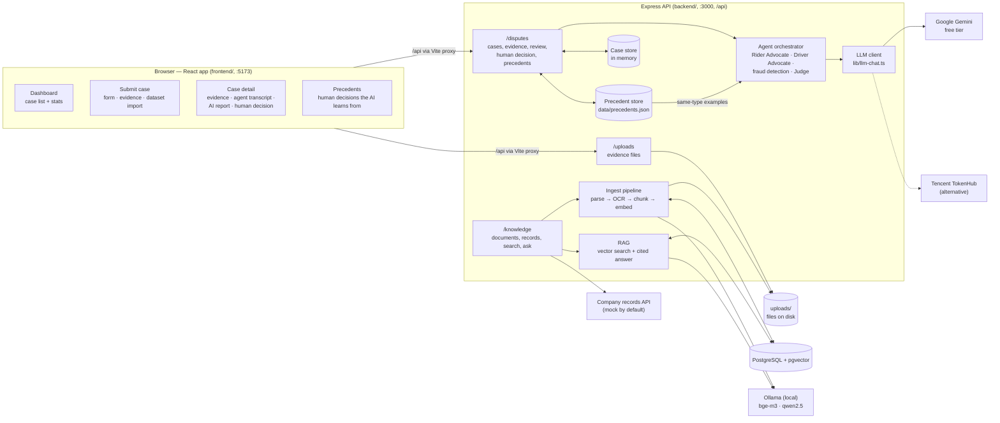
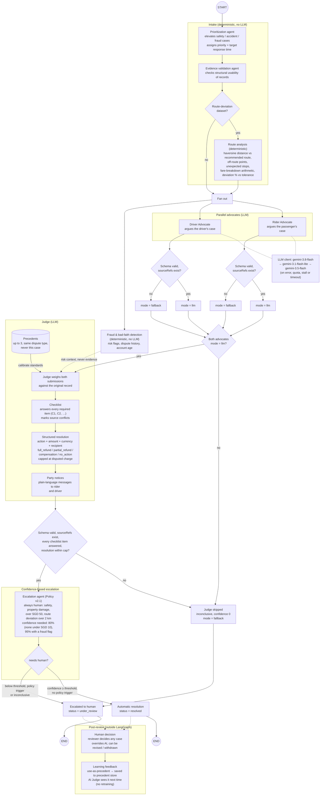
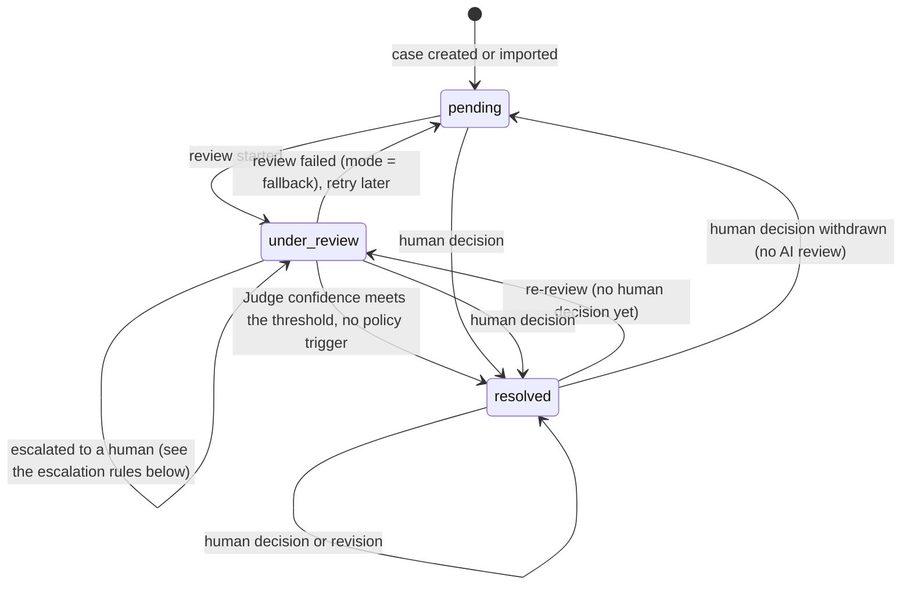

# Dispute Review Agent

AI-assisted review of ride-hailing disputes between drivers and riders. Reviewers submit cases,
upload evidence (PDFs, screenshots, photos, notes), pull company records, and ask questions that
are answered from that evidence with cited sources.

**Live application:** [Open RydeResolve](https://e411b34da14b46aeb1c115f80d4063e5.sg2.agentos-app.run/)

- **Frontend:** React 19 + Vite + TanStack Query + shadcn/ui + Tailwind CSS 4 (`frontend/`, port 5173)
- **Backend:** Express + TypeScript + Zod (`backend/`, port 3000, API under `/api`)
- **Knowledge base:** PostgreSQL + pgvector, local models via Ollama — all open source, no API keys

Feature list: [`docs/product/features.md`](docs/product/features.md) ·
Backend and API details: [`backend/README.md`](backend/README.md)

## Architecture



| Component | Where | What it does |
|---|---|---|
| Dashboard / Submit / Case detail | `frontend/src/pages/` | Pages for listing cases, creating one (by form, by loading the DISP-002 no-show or DISP-003 route-deviation sample, or from a dataset file such as those in `reference/`) and reviewing it |
| Agent review UI | `frontend/src/components/AgentReview.tsx` | Both advocates' submissions, the Judge's checklist and cited sources, the precedents it used, and the human judge panel |
| Precedents page | `frontend/src/pages/Precedents.tsx` | Lists the human decisions the AI Judge learns from; reviewers can delete any of them |
| Dispute routes + case store | `backend/src/modules/dispute/` | Case CRUD, evidence, review and human override; cases live **in memory** and reset on restart |
| Agents | `backend/src/modules/dispute/agents/` | Prioritization and evidence validation, then the Rider Advocate, Driver Advocate and fraud/bad-faith detection in parallel, then the Judge and escalation; every model output is schema-checked and its citations verified. The Judge must answer a checklist for the dispute type (`checklist.ts`) |
| Precedent store | `backend/src/modules/dispute/precedents.ts` | Human decisions marked "use as precedent", saved to `backend/data/precedents.json` so they survive restarts |
| LLM client | `backend/src/lib/llm-chat.ts` | Gemini free tier (`gemini-3.8-flash`, then fallback models), or TokenHub when no Gemini key is set |
| Evidence uploads | `backend/src/modules/dispute/uploads.ts` | Stores photos and PDFs attached to evidence. The agents see the file name, not the file contents |
| Knowledge base | `backend/src/modules/knowledge/` | Parses, embeds and searches documents and company records, and answers questions with citations using local models. Human decisions are also indexed here. **API only**: the agents do not read it and it has no page in the UI yet |

## How a dispute review works

The review runs as a LangGraph state machine (`agents/orchestrator.ts`). Each node writes
its output into a shared state; conditional edges route the flow based on confidence and
escalation rules.



The two advocates and the fraud/bad-faith detector run in parallel. The detector makes no model
call: it turns account risk flags, dispute history and account age into risk signals that the
Judge sees as context, never as evidence, so a review still makes three model calls. The advocates
each see the full record (including
`computed_route_analysis` for route-deviation cases). The Judge only runs when both
produced validated output, and no fallback ever picks a winner. The route-analysis step is
deterministic — it computes haversine distances, off-route points, unexpected stops, and
fare-breakdown arithmetic from the dataset's GPS telemetry, so the agents cite measured
numbers instead of estimating from raw coordinates.

**The AI learns from human decisions without retraining.** When a reviewer decides a case and ticks
"use as precedent", the decision and its reason are saved. The Judge is then shown up to 3 recent
precedents of the same dispute type (`PRECEDENT_EXAMPLES`) to calibrate how it applies policy and
weighs records against statements. Precedents are never treated as evidence, never cited, and a case
is never shown its own earlier decision. The **Precedents** page lists them, and deleting one stops the AI
using it.

**The Judge must answer a checklist** before ruling: the known weak spots for each dispute type (for
no-shows: arrival against scheduled time, the five-minute wait, both required contact attempts,
booked pickup location and fixed fee) plus statement-vs-record and timestamp conflicts. A ruling that skips an
item is rejected; each answer is shown with its citations and a conflict flag. Imported datasets are reviewed on
the original JSON, so evidence added to such a case after import is not used. Agent inputs, outputs
and failure rules: [`backend/src/modules/dispute/agents/README.md`](backend/src/modules/dispute/agents/README.md).

### Case status after a review



**Escalation rules (Policy v2.1, `agents/escalation-agent.ts`).** Safety incidents, disputed
property-damage claims, disputes over SGD 50 and route deviations over 2 km always go to a human. Otherwise the Judge must reach 80%
confidence (no minimum for disputes under SGD 10), or 95% when either party has a fraud flag. An
inconclusive ruling also goes to a human. So the DISP-003 sample (a 7.8 km deviation) is always
escalated, however confident the Judge is.

**Human judge.** A reviewer can decide any case at any time from its **Human review** panel, whether or not the
AI has reviewed it or escalated it. The decision needs a reason and can be revised or withdrawn
later. It overrides the AI: running the AI review again only updates the AI report shown for
reference, and the case stays resolved. Withdrawing the decision puts the case back to the AI
result (re-applying the escalation rules above), or to pending if the AI never reviewed it.

## Running locally

### Prerequisites

The app runs natively; only PostgreSQL runs in Docker.

- Node.js 22.12+ or 20.19+ (Vite 7 needs one of these) — e.g. `brew install fnm && fnm install 22`
- [Ollama](https://ollama.com), the native app — e.g. `brew install --cask ollama`. On macOS it is
  much faster than the Docker image because it uses the GPU.
- Docker (for PostgreSQL + pgvector) — or install PostgreSQL 13+ with pgvector 0.8+ natively

### 1. Start the database and models

From `dispute-review-agent/`, start PostgreSQL + pgvector (port 5432) and download the embedding
model (`bge-m3`, ~1.2 GB) and the answer model (`qwen2.5:7b`, ~4.7 GB):

```bash
docker compose up -d
ollama pull bge-m3
ollama pull qwen2.5:7b
```

`docker compose down` stops the database and keeps its data; `docker compose down -v` also
deletes the data. Without native Ollama, start its container with
`docker compose --profile ollama up -d` and pull the models with
`docker compose exec ollama ollama pull <model>`.

### 2. Backend (terminal 1)

Create your `.env` (skip this if you already have one, because it would replace your key):

```bash
cd backend
cp .env.example .env
```

Set `GEMINI_API_KEY` in `backend/.env` (free key: https://aistudio.google.com/apikey), then start
the API at http://localhost:3000/api. It creates the database tables on first start.

```bash
npm install
npm run dev
```

Check that everything is connected. The first shows which LLM provider and models the agents will
use, the second the database and local models:

```bash
curl localhost:3000/api/health/ready
curl localhost:3000/api/knowledge/health
```

### 3. Frontend (terminal 2)

From `dispute-review-agent/`, start the app at http://localhost:5173 (it proxies `/api` to the backend):

```bash
cd frontend
npm install
npm run dev
```

### 4. Load sample data (optional)

Run these from `dispute-review-agent/backend/`. Import mock company records for the DISP-002
no-show dispute:

```bash
curl -X POST 'localhost:3000/api/knowledge/company-records/import?wait=true' \
  -H 'Content-Type: application/json' -d '{"disputeId":"DISP-002"}'
```

Add a policy PDF, shared by all cases:

```bash
curl -X POST 'localhost:3000/api/knowledge/documents?wait=true' \
  -F "files=@../../reference/Code of Conduct – RYDE _ World's First Real-Time Carpooling App.pdf"
```

Ask a question:

```bash
curl -X POST localhost:3000/api/knowledge/ask -H 'Content-Type: application/json' \
  -d '{"question":"Did the driver try to contact the rider?","caseId":"DISP-002"}'
```

## Notes

- **Low-RAM machines:** `qwen2.5:7b` needs about 5 GB of free memory. `LLM_MODEL=qwen2.5:1.5b` fits
  in less but gives noticeably less accurate answers.
- **Speed:** answers take seconds with a GPU / Apple Silicon and around a minute on CPU only.
- **AI case review** uses the Gemini free tier (`GEMINI_API_KEY`). `gemini-3.8-flash` is tried
  first; if it errors, hits its quota, stalls or times out, the client moves to
  `GEMINI_FALLBACK_MODELS` (default `gemini-3.1-flash-lite,gemini-3.5-flash`). The free tier
  allows only about 20 requests per model per day and a review makes 3 calls, so expect the
  fallback model to take over after a few reviews. A review takes 15 s – 3 min. With no key at
  all (Gemini or `TOKENHUB_API_KEY`) the review fails safely: inconclusive, and the case stays
  pending. The knowledge base does not need a key.
- **Cases are kept in memory:** created and imported cases, reviews and human decisions are lost
  when the backend restarts. Precedents (`backend/data/precedents.json`), uploaded files and the
  knowledge base persist.
- **Company records** come from a mock of the internal API until `COMPANY_API_BASE_URL` is set.
- If PostgreSQL is not running the app still works; only `/api/knowledge/*` returns 503.
